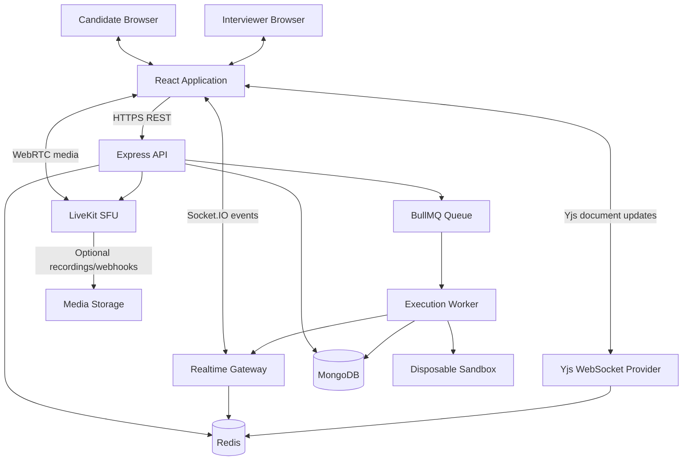
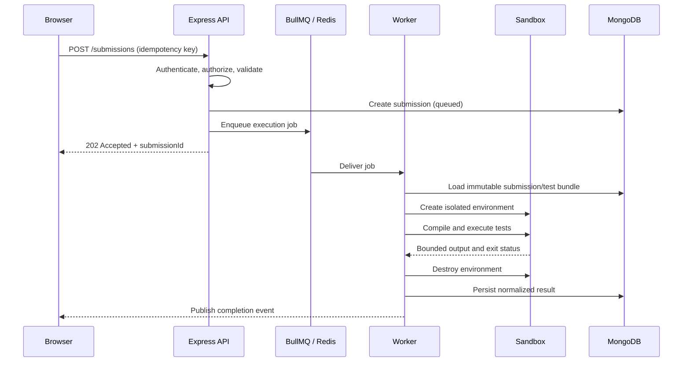

# System Architecture

## 1. Architecture decisions

| Concern                  | Decision                                                                          |
| ------------------------ | --------------------------------------------------------------------------------- |
| Frontend                 | React + TypeScript                                                                |
| Editor                   | Monaco Editor                                                                     |
| Backend                  | Node.js + Express                                                                 |
| Application architecture | MVC within a modular monolith                                                     |
| Database                 | MongoDB + Mongoose                                                                | mongodb atlas |
| Queue/cache              | Redis + BullMQ                                                                    |
| Collaboration            | Yjs with a WebSocket provider                                                     |
| Socket transport         | Socket.IO for application events/presence; Yjs updates over a compatible provider |
| Code execution           | Separate worker service using disposable containers                               |
| Initial isolation        | Hardened Docker; evaluate gVisor before public untrusted workloads                |
| Voice/video              | LiveKit (WebRTC/SFU)                                                              |
| Media assets             | Cloudinary where its media features fit                                           |
| General object storage   | Cloudflare R2 or another S3-compatible provider, optional                         |
| AI (Stage C)             | Provider-agnostic adapter/service                                                 |

## 2. High-level system



## 3. Control plane and execution plane

### Control plane

The Express application, realtime services, database, and queue coordinate users and work:

- Authentication and authorization.
- Organization and interview lifecycle.
- Question and test-case management.
- Submission intake.
- Queue creation and status tracking.
- Collaboration room authorization.
- LiveKit token issuance.
- Evaluation and audit records.

The control plane must never execute candidate source code directly.

### Execution plane

Execution workers consume jobs and run code in isolated sandboxes:

- Fetch the immutable submission payload and test bundle through a restricted internal interface.
- Create a fresh execution environment.
- Compile/run the candidate program.
- Evaluate tests without exposing hidden inputs or expected outputs.
- Enforce resource and time limits.
- Return normalized results.
- Destroy temporary resources.

Use a separate host/VM or isolated worker pool for execution. Do not mount the host Docker socket into the Express API container. Worker credentials must not permit broad database or organization access.

## 4. Backend module boundaries

Each module owns its routes/controllers, service layer, validation, and data access.

```text
src/
  app.js
  server.js
  config/
  shared/
    errors/
    middleware/
    validation/
    logger/
    events/
  modules/
    auth/
      auth.routes.js
      auth.controller.js
      auth.service.js
      auth.model.js
      auth.validation.js
    users/
    organizations/
    memberships/
    invitations/
    interviews/
    questions/
    submissions/
    evaluations/
    audit/
    realtime/
    media/
  infrastructure/
    database/
    redis/
    queues/
    livekit/
    storage/
workers/
  execution/
    worker.js
    job-handler.js
    sandbox-manager.js
    runtimes/
      javascript.js
      python.js
      cpp.js
```

The user requested MVC. Apply MVC within each module:

- **Model:** Mongoose schema/model and persistence concerns.
- **Controller:** HTTP request/response mapping; no business rules.
- **Service:** business rules and orchestration.
- **Routes:** endpoint registration and middleware.
- **Validation:** request schemas and payload validation.

Avoid a single global `models/` folder that causes every module to reach into every other module's data. A shared module may expose a narrow service interface.

## 5. Collaboration architecture

### Yjs

Use Yjs for collaborative text state. A Yjs document is authoritative for shared editor content during the session. A compatible Yjs WebSocket provider distributes document updates and awareness (cursor/presence) information.

Socket.IO is suitable for application-level events such as:

- participant_joined / participant_left
- interview_started / interview_ended
- editor_permission_changed
- submission_queued / submission_started / submission_completed
- chat_message_created
- interviewer_control_changed

Do not assume Socket.IO is automatically a Yjs provider. Use a supported Yjs provider or implement and test a deliberate adapter. Persist periodic Yjs snapshots and/or append updates to durable storage so a room can recover after reconnect or process restart. Redis pub/sub alone is not durable storage.

### Permissions

- Candidate and interviewer roles are checked server-side.
- The interviewer may grant/revoke candidate edit access.
- Read-only observers are a future role.
- Room tokens are short-lived and scoped to one interview.
- Never trust a client-supplied user ID or role.

## 6. Voice/video architecture

Use LiveKit as the WebRTC SFU/media layer. The Express backend:

1. Verifies the user is allowed into the interview.
2. Creates or selects the LiveKit room.
3. Issues a short-lived room token with least-privilege grants.
4. Returns connection details to the client.
5. Receives and verifies provider webhooks where required.

Media should flow between browser clients and LiveKit, not through Express or Socket.IO. Screen sharing is a WebRTC track. Recording/egress is optional, off by default, and subject to consent, access control, retention, and cost policy.

## 7. Execution architecture



### Queue rules

- Queue payload contains identifiers and immutable version references, not unrestricted database credentials or huge source bundles.
- Use a stable job ID or idempotency key to prevent duplicate submissions.
- Distinguish candidate outcomes from infrastructure failures.
- Retry only transient infrastructure failures with bounded attempts and backoff.
- Never retry a deterministic compile error or failed test as if it were a transient worker error.
- Enforce per-organization and global concurrency limits.
- Set queue retention/cleanup policies and dead-letter handling.

### Sandbox baseline

- Dedicated execution hosts/VMs.
- Fresh container per run or per strictly isolated job.
- Non-root UID/GID.
- No privileged mode, host PID/network namespace, or Docker socket.
- Drop Linux capabilities; apply seccomp/AppArmor or equivalent.
- Network disabled by default.
- Read-only root filesystem where practical.
- Bounded writable temporary directory.
- CPU, memory, PID, disk, and wall-time limits.
- Kill process tree on timeout.
- Capture bounded stdout/stderr; prevent output flooding.
- Destroy container and temporary files in a `finally`/cleanup path.
- Keep test harness and hidden cases out of candidate-visible output.
- Consider gVisor or Firecracker before accepting arbitrary internet traffic or high-risk multi-tenant workloads.

Docker isolation is not a complete security boundary. The deployment threat model must include container escape, kernel vulnerabilities, denial of service, malicious compiler inputs, and worker compromise.

## 8. Storage decisions

### MongoDB

Store structured application records: users, organizations, interviews, questions, submissions, execution results, evaluations, and audit events.

### Cloudinary

Use for media assets when transformations, playback delivery, and media management are useful. Do not use Cloudinary as the primary store for source code, hidden test cases, or high-volume execution logs.

### General object storage

If large artifacts are needed, use Cloudflare R2 or another S3-compatible object store for recordings, exports, and long-term logs. Keep object keys private and issue short-lived signed URLs after authorization. The system can start without this dependency.

### Ephemeral execution files

Keep source, compiled binaries, and test working files on bounded ephemeral worker storage. Delete after execution.

## 9. Stage C AI extension points

Add AI as a separate module/service, not as a dependency of the execution engine.

Possible interfaces:

- `AssessmentBlueprintService`: JD + company constraints -> draft blueprint.
- `FollowUpSuggestionService`: interview context + rubric -> interviewer-only suggestions.
- `CodeExplanationService`: source + compiler/runtime/test evidence -> explanation.
- `EvidenceSummaryService`: notes + events + submissions -> cited draft summary.

All AI outputs must be marked as suggestions, preserve provenance, and require human review. Do not send hidden test data, secrets, or unnecessary personal information to an LLM provider.

## 10. Deployment topology

Initial environments:

- Frontend web application.
- Express API service.
- Realtime/Yjs service (can initially share a process, but isolate logically).
- BullMQ execution worker service on separate compute.
- MongoDB managed instance or secured deployment.
- Redis managed instance or secured deployment.
- LiveKit Cloud initially, or self-hosted LiveKit when operational capability exists.
- Cloudinary for selected media.
- Optional Cloudflare R2 for general objects.

Use separate development, staging, and production credentials and databases. Execution workers should be deployed in a restricted network segment.

## 11. Observability

- Structured JSON logs with request ID, interview ID, submission ID, and worker job ID.
- Never log passwords, tokens, raw hidden tests, or unnecessary candidate code.
- Metrics: queue depth, wait time, execution duration, worker utilization, timeout rate, sandbox cleanup failures, socket reconnects, room participant counts, and API latency.
- Health and readiness checks for API, Redis, MongoDB, workers, and realtime services.
- Alerts for queue backlog, worker crash loops, abnormal resource use, and cleanup failures.
